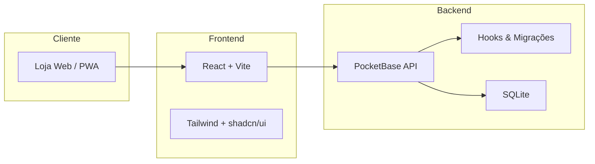

<div align="center">

# Livraria Adventista IASD

### Literatura cristã, educação e inspiração — experiência de compra digital premium

[](https://react.dev)
[](https://vitejs.dev)
[](https://pocketbase.io)
[](https://tailwindcss.com)
[](LICENSE)

**Loja online completa** com catálogo, checkout seguro, assinatura digital, entregas em Angola, painel administrativo e rastreio de encomendas em tempo real.

[Começar agora](#-início-rápido) · [Funcionalidades](#-funcionalidades) · [Arquitectura](#-arquitectura) · [Admin](#-painel-administrativo)

</div>

---

## Visão geral

A **Livraria Adventista IASD** é uma plataforma de e-commerce moderna, pensada para congregações, leitores e famílias que procuram literatura adventista com uma experiência fluida — do catálogo ao recibo, passando pela confirmação de entrega.

Construída como **monorepo** com frontend React e backend PocketBase, oferece controlo total sobre catálogo, encomendas, identidade visual e operações locais, sem dependência de plataformas fechadas.



---

## Funcionalidades

<table>
<tr>
<td width="50%">

### Loja & Catálogo
- Homepage com **hero slider** dinâmico
- Catálogo com pesquisa, filtros e coleções
- Pré-visualização rápida de produtos
- Carrinho persistente (localStorage)
- Tema visual personalizável (cores, glass UI, fundos)

</td>
<td width="50%">

### Checkout & Encomendas
- Checkout com **assinatura manuscrita** (P&B para recibo)
- Morada Angola (província → município → bairro)
- Telefone +244 formatado e contacto de parente
- Pagamento na entrega ou transferência
- Recibo HTML + partilha WhatsApp

</td>
</tr>
<tr>
<td>

### Entrega & Rastreio
- Envio standard / expresso / levantamento em loja
- Portes grátis acima de limiar configurável
- Página **Rastrear Encomenda** com timeline
- Estados de pagamento e entrega

</td>
<td>

### Administração
- Painel `/admin` com permissões por função
- Gestão de livros, slides, lojas e pagamentos
- Relatórios de vendas e alertas de stock
- Integrações (Google Drive, OAuth)
- Definições de marca e PWA

</td>
</tr>
</table>

---

## Stack tecnológica

| Camada | Tecnologias |
|--------|-------------|
| **Frontend** | React 18, Vite 7, React Router 7, Framer Motion |
| **UI** | Tailwind CSS, Radix UI, shadcn/ui, Lucide Icons |
| **Backend** | PocketBase (REST API, auth, ficheiros, hooks JS) |
| **Dados** | SQLite via PocketBase + migrações versionadas |
| **Extras** | PWA, react-helmet, Sonner toasts, assinatura canvas |

---

## Estrutura do projecto

```
livraria/
├── app/
│   ├── web/                 # Frontend React (porta 3000)
│   │   ├── src/
│   │   │   ├── components/  # UI, carrinho, assinatura, admin
│   │   │   ├── pages/       # Loja, perfil, rastreio, admin
│   │   │   ├── hooks/       # Auth, carrinho, definições
│   │   │   └── lib/         # Recibos, telefone AO, temas
│   │   └── public/          # PWA, ícones, service worker
│   └── pocketbase/          # Backend (porta 8090)
│       ├── pb_hooks/        # APIs custom (checkout, settings)
│       ├── pb_migrations/   # Schema & evolução da BD
│       └── scripts/         # Start automático + seed
├── package.json             # Scripts do monorepo
└── README.md
```

---

## Início rápido

### Pré-requisitos

- **Node.js 18+** e npm
- macOS, Linux ou Windows (WSL recomendado)

### 1. Clonar e instalar

```bash
git clone git@github.com:ValentinoCanguele/livraria_IASD.git
cd livraria_IASD
npm install
```

### 2. Configurar ambiente

```bash
cp app/web/.env.example app/web/.env
```

```env
VITE_POCKETBASE_URL=http://127.0.0.1:8090
```

### 3. Executar em desenvolvimento

```bash
npm run dev
```

| Serviço | URL |
|---------|-----|
| Loja | http://localhost:3000 |
| API PocketBase | http://127.0.0.1:8090 |
| Admin PocketBase | http://127.0.0.1:8090/_/ |

> Na primeira execução, o binário PocketBase é descarregado automaticamente.

### 4. Dados iniciais (seed)

```bash
npm run seed
```

---

## Painel administrativo

### Aplicação (`/login`)

| Campo | Valor |
|-------|-------|
| Email | `admin@livraria.ao` |
| Password | `admin123456` |

### PocketBase (`/_/`)

| Campo | Valor |
|-------|-------|
| Email | `admin@livraria.local` |
| Password | `Admin123456!` |

> Altere estas credenciais antes de qualquer ambiente público.

---

## Scripts disponíveis

| Comando | Descrição |
|---------|-----------|
| `npm run dev` | Frontend + PocketBase em modo desenvolvimento |
| `npm run build` | Build de produção do frontend → `dist/app/web` |
| `npm run start` | PocketBase + preview do frontend |
| `npm run seed` | Cria superuser, admin e livros de exemplo |
| `npm run seed:books` | Repõe livros e slides em falta |
| `npm run lint` | ESLint no frontend |

---

## APIs customizadas (PocketBase Hooks)

| Endpoint | Método | Descrição |
|----------|--------|-----------|
| `/api/app/settings` | GET | Definições públicas do site |
| `/api/app/checkout` | POST | Finalizar compra com assinatura |
| `/api/app/track` | GET | Rastreio de encomenda |
| `/api/app/newsletter` | POST | Subscrição de newsletter |
| `/api/app/integrations` | GET | Integrações activas |
| `/api/app/messaging/status` | GET | Estado WhatsApp/email/push (sem segredos) |
| `/api/app/whatsapp/receipt` | POST | Enviar recibo via WhatsApp API |
| `/api/app/admin/whatsapp/test` | POST | Teste de envio (staff) |

> Guia completo de lançamento: [docs/LANCAMENTO.md](docs/LANCAMENTO.md)  
> Arquitectura PocketBase + Firebase: [docs/ARQUITETURA.md](docs/ARQUITETURA.md)

---

## Destaques de implementação

- **Assinatura no checkout** — captura em canvas, exportação P&B nítida e anexo ao recibo com nome e data
- **Telefone Angola** — normalização e validação `+244 9XX XXX XXX` em todo o fluxo
- **Selector geográfico** — províncias, municípios e localidades de Angola (com fallback offline)
- **Tema da loja** — cores de marca, glass morphism e fundos gradiente/imagem/vídeo/slides
- **PWA** — instalável no telemóvel com manifest e service worker
- **Permissões** — roles `admin`, `manager` e `member` com controlo granular no admin

---

## Build de produção

```bash
npm run build
npm run start
```

O frontend compilado fica em `dist/app/web`. Configure o reverse proxy (Nginx, Caddy, etc.) para servir os ficheiros estáticos e expor o PocketBase na mesma origem ou subdomínio API.

---

## Segurança & boas práticas

- Nunca commitar `.env` — use `.env.example` como referência
- `pb_data/` (base de dados local) está no `.gitignore`
- Alterar passwords padrão antes de deploy
- Activar HTTPS em produção
- Rever permissões de coleções no PocketBase Admin

---

## Contribuir

1. Faça fork do repositório
2. Crie uma branch: `git checkout -b feature/minha-funcionalidade`
3. Commit: `git commit -m "feat: descrição clara"`
4. Push: `git push origin feature/minha-funcionalidade`
5. Abra um Pull Request

---

<div align="center">

**Livraria Adventista IASD**

*Literatura que edifica e transforma.*

Feito com dedicação para a comunidade adventista em Angola e além-fronteiras.

</div>
