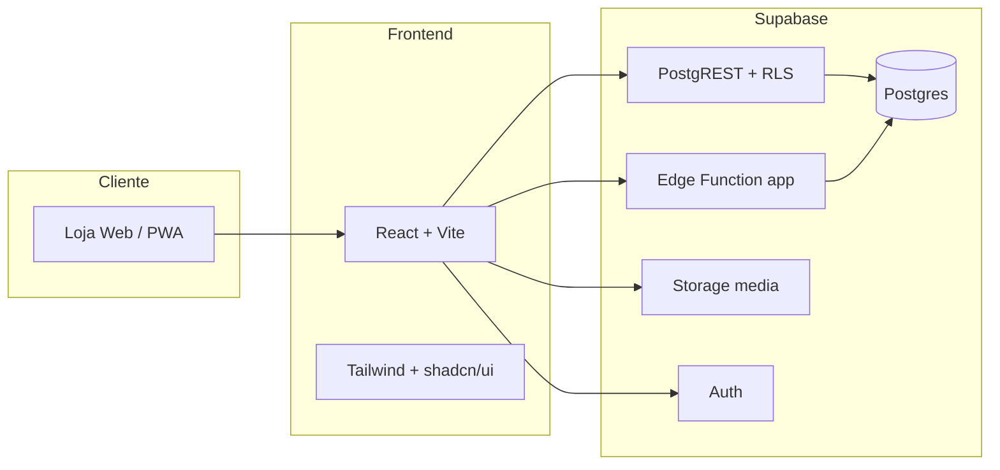

<div align="center">

# Livraria Adventista IASD

### Literatura cristã, educação e inspiração — experiência de compra digital premium

[](https://react.dev)
[](https://vitejs.dev)
[](https://supabase.com)
[](https://tailwindcss.com)


**Loja online completa** com catálogo, checkout seguro, assinatura digital, entregas em Angola, painel administrativo e rastreio de encomendas em tempo real.

[Começar agora](#-início-rápido) · [Funcionalidades](#-funcionalidades) · [Arquitectura](#-arquitectura) · [Admin](#-painel-administrativo)

</div>

---

## Visão geral

A **Livraria Adventista IASD** é uma plataforma de e-commerce moderna, pensada para congregações, leitores e famílias que procuram literatura adventista com uma experiência fluida — do catálogo ao recibo, passando pela confirmação de entrega.

Construída como **monorepo** com frontend React e backend **Supabase** (Postgres, Auth, Storage e Edge Functions), oferece controlo total sobre catálogo, encomendas, identidade visual e operações locais. O frontend é publicado no **Cloudflare Pages**.



---

## Funcionalidades

<table>
<tr>
<td width="50%">

### Loja & Catálogo
- Homepage com **hero slider** dinâmico
- Catálogo com pesquisa, filtros e coleções
- Pré-visualização rápida de produtos
- Carrinho persistente (localStorage)
- Tema visual personalizável (cores, glass UI, fundos)

</td>
<td width="50%">

### Checkout & Encomendas
- Checkout com **assinatura manuscrita** (P&B para recibo)
- Morada Angola (província → município → bairro)
- Telefone +244 formatado e contacto de parente
- Pagamento na entrega ou transferência
- Recibo HTML + partilha WhatsApp

</td>
</tr>
<tr>
<td>

### Entrega & Rastreio
- Envio standard / expresso / levantamento em loja
- Portes grátis acima de limiar configurável
- Página **Rastrear Encomenda** com timeline
- Estados de pagamento e entrega

</td>
<td>

### Administração
- Painel `/admin` com permissões por função
- Gestão de livros, slides, lojas e pagamentos
- Relatórios de vendas e alertas de stock
- Integrações (Google Drive, OAuth)
- Definições de marca e PWA

</td>
</tr>
</table>

---

## Stack tecnológica

| Camada | Tecnologias |
|--------|-------------|
| **Frontend** | React 18, Vite 7, React Router 7, Framer Motion |
| **UI** | Tailwind CSS, Radix UI, shadcn/ui, Lucide Icons |
| **Backend** | Supabase: Postgres com RLS, Auth, Storage e Edge Function `app` (Deno) |
| **Dados** | Postgres + migrações SQL versionadas em `supabase/migrations` |
| **Deploy** | Cloudflare Pages (frontend) via GitHub Actions |
| **Extras** | PWA, react-helmet, Sonner toasts, assinatura canvas |

---

## Estrutura do projecto

```
livraria/
├── app/
│   ├── web/                 # Frontend React (porta 3000)
│   │   ├── src/
│   │   │   ├── components/  # UI, carrinho, assinatura, admin
│   │   │   ├── pages/       # Loja, perfil, rastreio, admin
│   │   │   ├── hooks/       # Auth, carrinho, definições
│   │   │   └── lib/         # Recibos, telefone AO, temas
│   │   └── public/          # PWA, ícones, service worker
├── supabase/
│   ├── migrations/          # Esquema, RLS, triggers, Storage
│   ├── functions/app/       # API própria (checkout, rastreio, CRM, chat…)
│   └── config.toml
├── docs/                    # Arquitectura, lançamento e passagem de trabalho
├── .github/workflows/       # Verificação de PRs e deploy (Cloudflare Pages e Supabase)
├── package.json             # Scripts do monorepo
└── README.md
```

---

## Início rápido

### Pré-requisitos

- **Node.js 18+** e npm
- macOS, Linux ou Windows (WSL recomendado)

### 1. Clonar e instalar

```bash
git clone https://github.com/fernandotunas6-bot/Livraria-Editora-Adventista.git
cd Livraria-Editora-Adventista
npm install
```

### 2. Configurar ambiente

```bash
cp app/web/.env.example app/web/.env
```

```env
VITE_SUPABASE_URL=https://bggqkjjqbjhbjsckzopj.supabase.co
VITE_SUPABASE_PUBLISHABLE_KEY=sb_publishable_…
```

A chave *publishable* é pública. A chave `service_role` / `sb_secret_…` nunca vai para o frontend nem para o repositório.

### 3. Executar em desenvolvimento

```bash
npm run dev
```

| Serviço | URL |
|---------|-----|
| Loja | http://localhost:3000 |
| API (Edge Function) | https://bggqkjjqbjhbjsckzopj.supabase.co/functions/v1/app |
| Painel Supabase | https://supabase.com/dashboard/project/bggqkjjqbjhbjsckzopj |

Não é preciso correr nenhum servidor local além do Vite: os dados estão no Supabase.

---

## Painel administrativo

### Acesso (`/login`)

Entra-se com email e palavra-passe ou com Google (Supabase Auth). Os papéis estão na tabela `profiles`:

| Papel | Acesso |
|-------|--------|
| `admin` | Tudo, incluindo a equipa, papéis, permissões e integrações |
| `manager` | Só as áreas activas nas suas permissões (catálogo, encomendas, configurações, utilizadores e clientes, pagamentos, marketing) |
| `member` | Cliente: compra e acompanha as suas encomendas |

As permissões são verificadas também no servidor (políticas RLS com `private.has_permission` e a Edge Function).
Contas e papéis geram-se em **Admin → Utilizadores e Clientes**. Para dar acesso de administrador a alguém que ainda não tem conta, acrescente o email a `private.admin_emails` no Supabase: a conta fica admin quando for confirmada.

> Nunca escreva credenciais reais neste repositório. É privado, mas o histórico do git é permanente e a visibilidade pode mudar.

---

## Scripts disponíveis

| Comando | Descrição |
|---------|-----------|
| `npm run dev` | Frontend em modo desenvolvimento (dados no Supabase) |
| `npm run build` | Build de produção do frontend → `dist/app/web` |
| `npm run start` | Preview do build de produção |
| `npm run lint` | ESLint no frontend |

---

## API própria (Edge Function `app`)

| Endpoint | Método | Descrição |
|----------|--------|-----------|
Base: `https://bggqkjjqbjhbjsckzopj.supabase.co/functions/v1/app`

| Endpoint | Método | Descrição |
|----------|--------|-----------|
| `/settings` | GET | Definições públicas do site |
| `/checkout` | POST | Finalizar compra com assinatura (transacção em `place_order`) |
| `/track` | POST | Rastreio de encomenda |
| `/newsletter` | POST | Subscrição de newsletter |
| `/integrations` | GET | Integrações activas |
| `/messaging/status` | GET | Estado WhatsApp/email/push (sem segredos) |
| `/whatsapp/receipt` | POST | Enviar recibo via WhatsApp API |
| `/admin/whatsapp/test` | POST | Teste de envio (staff) |
| `/chat`, `/chat/config` | POST/GET | Assistente (Gemini/DeepSeek ou FAQ) |
| `/contacts/*` | — | CRM: sincronização, notificações e campanhas (staff) |
| `/admin/users*` | GET/POST | Utilizadores e clientes: listar, criar, editar, suspender, link de acesso, apagar (permissão `manage_users`) |

O frontend usa uma API ao estilo `pb.collection(...)` (herdada do PocketBase), implementada sobre o Supabase em `app/web/src/lib/dataClient.js`.

> Guia de lançamento: [docs/LANCAMENTO.md](docs/LANCAMENTO.md) · Arquitectura: [docs/ARQUITETURA.md](docs/ARQUITETURA.md) · Passagem de trabalho: [docs/HANDOFF.md](docs/HANDOFF.md) · Migração do repositório: [docs/MIGRACAO-REPOSITORIO.md](docs/MIGRACAO-REPOSITORIO.md)  
> O login (email e Google) é do Supabase Auth. O Firebase fica só para as ferramentas do Google Workspace no painel.

---

## Destaques de implementação

- **Assinatura no checkout** — captura em canvas, exportação P&B nítida e anexo ao recibo com nome e data
- **Telefone Angola** — normalização e validação `+244 9XX XXX XXX` em todo o fluxo
- **Selector geográfico** — províncias, municípios e localidades de Angola (com fallback offline)
- **Tema da loja** — cores de marca, glass morphism e fundos gradiente/imagem/vídeo/slides
- **PWA** — instalável no telemóvel com manifest e service worker
- **Permissões** — roles `admin`, `manager` e `member` com controlo granular no admin

---

## Build de produção

Cada push para `main` publica automaticamente:

- **Frontend** → Cloudflare Pages (`.github/workflows/deploy-cloudflare.yml`)
- **Migrações e Edge Function** → Supabase (`.github/workflows/deploy-supabase.yml`, só quando `supabase/` muda)

Configuração no GitHub (Settings → Secrets and variables → Actions). Num repositório novo isto tem de ser criado à mão — ver [docs/MIGRACAO-REPOSITORIO.md](docs/MIGRACAO-REPOSITORIO.md):

| Tipo | Nome | Valor |
|------|------|-------|
| Variável | `VITE_SUPABASE_URL` | URL do projecto Supabase |
| Variável | `VITE_SUPABASE_PUBLISHABLE_KEY` | Chave publishable |
| Variável | `CLOUDFLARE_PAGES_PROJECT` | `livraria-editora-adventista` |
| Variável | `SUPABASE_PROJECT_REF` | `bggqkjjqbjhbjsckzopj` |
| Secret | `CLOUDFLARE_API_TOKEN` | Token com permissão *Cloudflare Pages: Edit* |
| Secret | `CLOUDFLARE_ACCOUNT_ID` | ID da conta Cloudflare |
| Secret | `SUPABASE_ACCESS_TOKEN` | Token pessoal do Supabase |
| Secret | `SUPABASE_DB_PASSWORD` | Palavra-passe da base de dados |

O ficheiro `app/web/public/_redirects` encaminha todas as rotas para `index.html` (SPA).

---

## Segurança & boas práticas

- Nunca commitar `.env` — use `.env.example` como referência
- A chave `service_role` só existe dentro das Edge Functions do Supabase
- Nunca escrever credenciais reais no repositório (é privado, mas o histórico do git guarda tudo para sempre)
- Activar HTTPS em produção
- Rever as políticas RLS e os avisos em Supabase → Advisors

---

## Contribuir

1. Peça acesso de colaborador (o repositório é privado) e clone-o
2. Crie uma branch: `git checkout -b feature/minha-funcionalidade`
3. Commit: `git commit -m "feat: descrição clara"`
4. Push: `git push origin feature/minha-funcionalidade`
5. Abra um Pull Request

---

<div align="center">

**Livraria Adventista IASD**

*Literatura que edifica e transforma.*

Feito com dedicação para a comunidade adventista em Angola e além-fronteiras.

</div>
