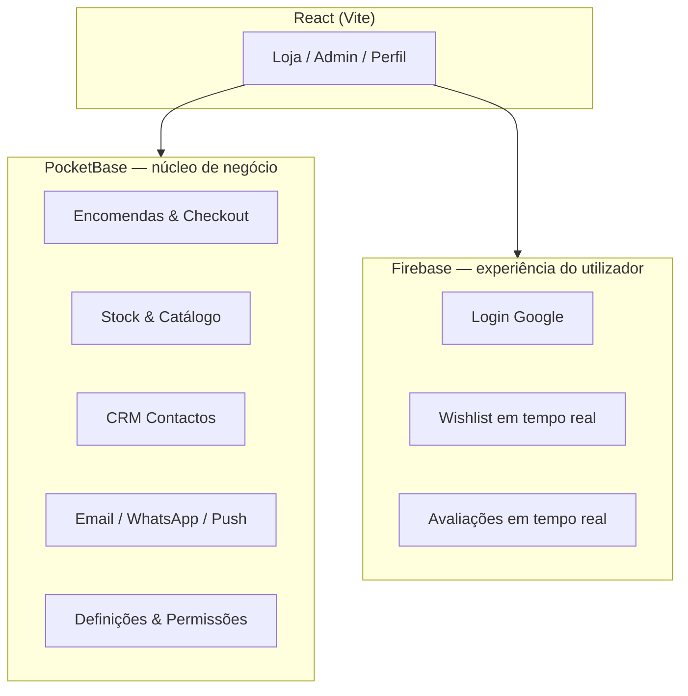

# Arquitectura — PocketBase + Firebase

A livraria usa **dois backends complementares**, não concorrentes. Esta é a abordagem recomendada e já está parcialmente implementada.

## Visão geral

---

## Quem faz o quê?

| Dados / função | Onde | Porquê |
|----------------|------|--------|
| Livros, stock, encomendas | **PocketBase** | Relacional, admin, hooks servidor, Angola |
| Checkout, assinatura, rastreio | **PocketBase** | Lógica de negócio no servidor |
| CRM, campanhas, WhatsApp API | **PocketBase** | Segredos no servidor, não no cliente |
| Email SMTP / SendGrid | **PocketBase** | Envio seguro server-side |
| Login Google (rápido) | **Firebase Auth** | OAuth simples, avatar Google |
| Lista de desejos | **Firestore** | Sync em tempo real por utilizador |
| Avaliações de livros | **Firestore** | Leitura/escrita em tempo real |
| Push PWA (futuro FCM) | **PocketBase + SW** | VAPID local; FCM opcional via Firebase |

---

## Abordagem actual vs alternativas

### ✅ Recomendado: híbrido (o que temos)

**PocketBase** = sistema de loja (fonte de verdade comercial)  
**Firebase** = dados pessoais em tempo real + login social

**Vantagens**
- Não descarta o investimento Firebase já feito
- Admin e checkout num só sítio (PocketBase)
- Wishlist/reviews instantâneos sem sobrecarregar o PB
- Segredos (WhatsApp, SMTP) ficam nos hooks PB

**Desvantagens**
- Dois sistemas para manter (mitigado: papéis bem definidos)
- Utilizador Firebase não acede ao CRM sem login PB (staff)

### Alternativa A — só PocketBase

Migrar wishlist e reviews para coleções PB.

- **Pró:** um único backend
- **Contra:** perde sync Firestore em tempo real; mais trabalho de migração

### Alternativa B — só Firebase

Catálogo e encomendas no Firestore + Cloud Functions.

- **Pró:** ecossistema Google unificado
- **Contra:** CRM, hooks Angola, PocketBase admin e custos Firebase maiores; já investiu em PB

### Alternativa C — Firebase como espelho/analytics

PB continua master; Firebase recebe eventos (Analytics, opcional backup).

- **Pró:** relatórios Google Analytics / BigQuery
- **Contra:** duplicação de dados se não for só leitura

---

## Autenticação hoje

| Método | Sistema | Acesso |
|--------|---------|--------|
| Email + password | PocketBase | Loja, perfil, admin (conforme role) |
| Google (Firebase) | Firebase Auth | Loja, wishlist, reviews |
| Staff CRM | PocketBase obrigatório | Admin, marketing |

**Melhoria futura (opcional):** ligar conta Firebase ↔ PocketBase pelo mesmo email (`pb_uid` no Firestore ou `firebase_uid` em `users`), para um único perfil com ambos os mundos.

---

## Regra prática para novas funcionalidades

1. **Dinheiro, stock, legal, staff** → PocketBase  
2. **Preferências pessoais em tempo real** → Firestore  
3. **Login social** → Firebase Auth (ou PocketBase OAuth Google como alternativa)  
4. **Nunca** guardar tokens WhatsApp/SMTP no Firebase cliente

---

## Ficheiros relevantes

| Ficheiro | Papel |
|----------|--------|
| `app/pocketbase/pb_hooks/main.pb.js` | APIs checkout, CRM, messaging |
| `app/web/src/lib/firebaseClient.js` | Firestore + Firebase Auth |
| `app/web/src/hooks/useAuth.jsx` | Ponte PB + Firebase |
| `app/web/src/hooks/useWishlist.jsx` | Firestore wishlists |
| `app/web/src/hooks/useReviews.jsx` | Firestore reviews |

---

## Conclusão

**Manter o híbrido actual é a melhor opção** para a livraria: PocketBase como motor da loja e Firebase para experiência do leitor (Google, wishlist, reviews). Não é preciso descartar nenhum dos dois — só respeitar a divisão de responsabilidades acima.

Para lançamento, priorize configurar PocketBase (ver [LANCAMENTO.md](./LANCAMENTO.md)); Firebase já funciona para wishlist e login Google.
