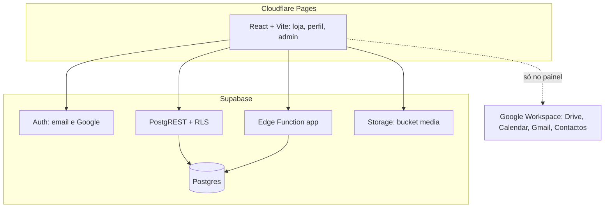

# Arquitectura — Supabase + Cloudflare Pages

A loja tem um único backend, o **Supabase**. O frontend é uma aplicação React estática publicada no **Cloudflare Pages**.
O PocketBase (backend original) foi retirado depois da migração. O Firebase fica só para as ferramentas do Google Workspace no painel.

## Visão geral

## Quem faz o quê

| Dados / função | Onde | Notas |
|----------------|------|-------|
| Livros, colecções, slides, lojas, métodos de pagamento | Postgres (PostgREST) | Leitura pública do que está activo; escrita conforme a permissão |
| Checkout, rastreio, confirmação de entrega | Edge Function `app` | Transacção em `place_order` (stock, preços e totais no servidor) |
| Email (SMTP/SendGrid) e WhatsApp Business API | Edge Function `app` | Segredos só no servidor; cada envio fica em `notification_logs` |
| Atendimento cliente-equipa e alertas pessoais | Postgres + RLS/RPCs | Migração `20261103165632_centro_atendimento_notificacoes` aplicada; clientes vêem apenas as suas conversas/alertas e a equipa usa `manage_orders` |
| CRM: contactos, grupos, campanhas | Postgres + Edge Function `/contacts/*` | Permissão `manage_users` ou `manage_marketing`, ou dono do contacto |
| Utilizadores e clientes | Edge Function `/admin/users*` + `admin_users_list` | Ver "Permissões" abaixo |
| Lista de desejos e avaliações | Postgres (`wishlists`, `book_reviews`) | "Compra verificada" definida por trigger |
| Imagens (capas, logótipo, avatares) | Storage, bucket `media` | `<tabela>/<id>/<ficheiro>` |
| Login | Supabase Auth | Email e palavra-passe, ou Google |
| Google Workspace no painel | Firebase Auth (popup) + APIs Google | Só para obter o token de acesso às APIs Google |

O frontend usa `app/web/src/lib/dataClient.js`, uma camada com a API ao estilo `pb.collection(...)` (herdada do PocketBase) implementada sobre o Supabase.

## Permissões

| Papel | O que pode |
|-------|------------|
| `admin` | Tudo, incluindo a equipa, papéis, permissões, integrações e o registo de comunicações |
| `manager` | Só as áreas activas em `profiles.permissions` |
| `member` | Cliente: as suas encomendas, lista de desejos, avaliações, perfil e atendimento |

Permissões dos gestores: `manage_catalog`, `manage_orders`, `manage_settings`, `manage_users`, `manage_payments`, `manage_marketing`.

A mesma regra é aplicada em três sítios:

1. **Base de dados:** `private.has_permission(chave)` nas políticas RLS.
2. **Edge Function:** `can()` e `requirePermission()`.
3. **Frontend:** `app/web/src/lib/permissions.js` (só para mostrar ou esconder; a segurança está nos dois primeiros).

Outras regras:
- Administradores pré-autorizados: um email em `private.admin_emails` (fora da API e do repositório) passa a admin quando a conta fica confirmada.
- Na gestão de utilizadores, ninguém se apaga nem se suspende a si próprio, e fica sempre pelo menos um administrador activo.

## Migrações

As migrações estão em `supabase/migrations/`. Cada ficheiro tem de ter **a mesma versão e o mesmo SQL** que está registado em `supabase_migrations.schema_migrations`; caso contrário, `supabase db push` no deploy falha. Ver as regras em [HANDOFF.md](HANDOFF.md).

## Deploy

| O quê | Como |
|-------|------|
| Verificação de cada PR | `.github/workflows/ci.yml`: lint, build e `deno check` |
| Site | `.github/workflows/deploy-cloudflare.yml` em cada push para `main` |
| Migrações e Edge Function | `.github/workflows/deploy-supabase.yml` quando `supabase/` muda no `main` |
